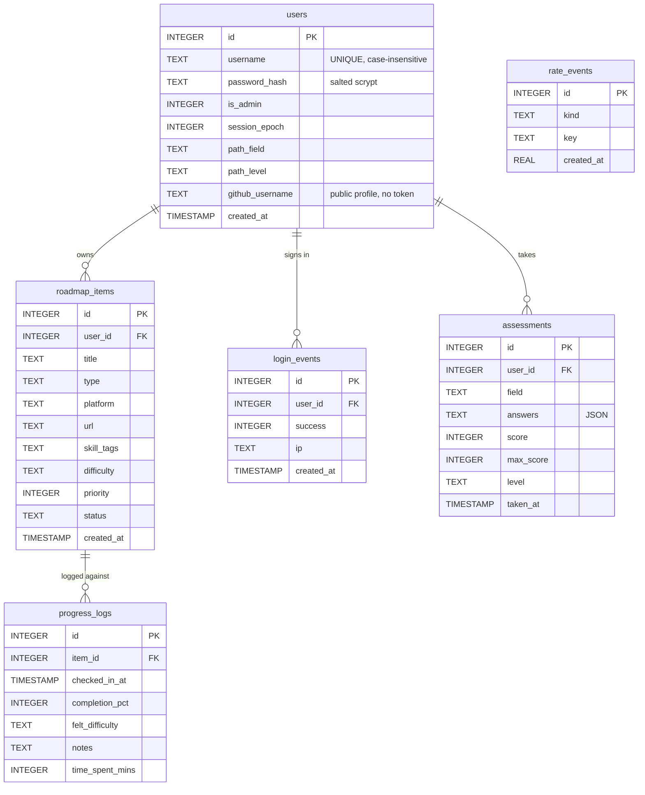

# Cybersecurity Career Roadmap Tracker

A web app for planning and tracking a career in cybersecurity. Pick the field you want to work in, find out your level with a short assessment, follow a phased learning timeline, log your study sessions, and see where your time goes.

Single-process Flask app, server-rendered with Jinja2, data in one SQLite file. Built for the IE University DevOps individual assignment.

## Features

| Page | What it does |
|---|---|
| **Roadmap** (`/`) | Horizontal timeline for your chosen field and level: five phases with estimated durations and dates. Each phase is marked *covered at your level*, *done*, *current* or *locked*. The current phase lists its learning resources and can add them all to your roadmap in one click (titles you already have are skipped). Field and level can be switched from menus at the top. |
| **Progress** (`/progress`) | Every roadmap item with status, priority, difficulty, tags and completion bar; stats, tag cloud, search and filters. Item pages hold the session log: completion %, how hard it felt, minutes spent, notes. Logging 100% completes the item automatically. |
| **Stats** (`/stats`) | Month calendar shaded by minutes studied, total hours, current and longest streak, time per skill tag, and a 12-week bar chart. |
| **Projects** (`/projects`) | Link your public GitHub profile by username: your most recently pushed repositories (language, stars, last push), pushes and active days in the last 30 days, and a button to add a repository to your roadmap as a project, so you can log progress on it. Read-only: no GitHub password or token is asked for or stored. |
| **Assessment** (`/assessment`) | Nine career fields with seven multiple-choice questions each. Scores you as just starting / beginner / intermediate / advanced, lists strengths and gaps per skill, and suggests roles and freelance work for that level. Results are kept, so retakes show progress. Finishing an assessment sets your timeline. |
| **Resources** (`/recommendations`) | YouTube videos for the skills you rate as hard or brutal (trusted security channels first) and learning platforms worth paying for. |
| **Profile** (`/settings`) | Sign-in history with failed-attempt warning, change password, delete account, and download all your data as JSON or CSV. |
| **Admin** (`/admin`) | Admin accounts only: user overview, delete users, view and lift login lockouts. |

## Quick start

Requires Python 3.10 or newer.

```bash
git clone https://github.com/G-Lifshitz/cybersec-roadmap.git
cd cybersec-roadmap
python -m venv .venv
source .venv/bin/activate          # Windows: .venv\Scripts\activate
pip install -r requirements.txt
cp .env.example .env               # then edit SECRET_KEY (see below)
python app.py
```

Open http://localhost:5000 and create an account. The database and its tables are created automatically on first start; there is no setup step.

## Configuration

All configuration comes from environment variables (or a `.env` file, loaded with python-dotenv). Nothing secret is hard-coded.

| Variable | Default | Purpose |
|---|---|---|
| `PORT` | `5000` | Port the server listens on (always bound to `0.0.0.0`). |
| `SECRET_KEY` | random per start | Signs the session cookie. Set it to a long random string, otherwise every restart logs everyone out. |
| `DATA_DIR` | `.` | Folder that holds `roadmap.db`. Point it at a persistent volume when deployed. |
| `YOUTUBE_API_KEY` | *(empty)* | YouTube Data API v3 key. Optional: without it the app works and the video sections are simply empty. |
| `ADMIN_USERNAME` / `ADMIN_PASSWORD` | *(empty)* | If both are set, that account is created (or promoted) as admin at startup. Leave empty for no admin. |
| `FLASK_DEBUG` | `0` | `1` turns on Flask debug mode. Never in production. |

Example production start:

```bash
PORT=8080 DATA_DIR=/data SECRET_KEY=<long-random-string> python app.py
```

## Tests

```bash
python -m pytest tests/ --cov=models --cov=ui --cov=services.assessment --cov=services.timelines --cov=services.export --cov=services.stats --cov=services.github --cov-report=term-missing
```

Current result: **273 tests passing, 100% line coverage** on `models/`, `ui/` and the five logic services. Tests run against a throwaway SQLite file and include security cases: another user's ids, SQL injection payloads, lockout windows, CSV formula injection, hostile GitHub usernames and links. `GitHubService` receives its HTTP call and clock as parameters, so it is tested with canned responses and never touches the network. Routes and templates are checked by hand, and `services/youtube.py` is not unit-tested because that would mean mocking Google's API (see ADR 4).

## Project structure

```
cybersec-roadmap/
├── app.py                    # Flask app: routes, auth decorators, composition root
├── db.py                     # SQLite connection (Singleton), schema, migrations
├── models/                   # Data access: one module per domain, raw parameterised SQL
│   ├── roadmap.py            #   roadmap items (planning)
│   ├── progress.py           #   progress logs (tracking)
│   ├── users.py              #   accounts, login history
│   ├── assessment.py         #   saved assessment attempts
│   └── ratelimit.py          #   sliding-window attempt limits
├── services/                 # Logic and data that isn't SQL
│   ├── assessment.py         #   scoring (Questionnaire)
│   ├── question_bank.py      #   assessment questions (data)
│   ├── timelines.py          #   timeline planning (TimelinePlanner)
│   ├── timeline_catalog.py   #   learning phases per field (data)
│   ├── stats.py              #   streaks, calendar, weekly and per-skill totals
│   ├── export.py             #   personal data export (JSON / CSV)
│   ├── github.py             #   linked GitHub profiles (GitHubService facade)
│   └── youtube.py            #   YouTube API wrapper (RecommendationService facade)
├── ui/                       # Sidebar links and icons, defined as data
├── templates/                # Jinja2 pages
├── static/style.css
├── tests/                    # pytest suite
├── ADR.md                    # Architecture decision records
├── requirements.txt
└── .env.example
```

## Architecture

- **One process, one SQLite file.** `db.py` holds a single shared connection (Singleton) with `row_factory = sqlite3.Row` and `PRAGMA foreign_keys = ON`. `init_db()` runs at startup, is safe to run every time, and `_migrate()` adds columns introduced after a database was first created.
- **Domains don't import each other.** Roadmap (what you plan) and progress (what you did) are separate modules; so are users, assessments and rate limits. Where a page needs several domains, a route or a service combines them.
- **Data separate from logic.** The question bank and the timeline catalogue are plain Python data. They are passed into `Questionnaire` and `TimelinePlanner` in `app.py` (dependency injection), so the logic is tested with small fake data and the content can change without touching code.
- **Thin routes.** Routes read the request, call a model or service, and render. Calculations (scores, timeline states, streaks, chart coordinates) live in services as pure functions that take `today` as a parameter.
- **Almost no JavaScript.** Menus are `<details>` elements, charts are SVG drawn from Python-computed coordinates. The only JavaScript is a few inline attributes: delete confirmations, auto-submitting filter dropdowns and the slider label.
- **Design patterns:** Singleton (`_DatabaseManager`), Facade (`RecommendationService`, `GitHubService`), Decorator (`login_required`, `admin_required`), dependency injection (question bank, timeline catalogue, and the HTTP call and clock in `GitHubService`).

### Database



Every foreign key uses `ON DELETE CASCADE`, so deleting an account removes all of its rows. Progress logs belong to a user through their item. `rate_events` is deliberately not linked to users: it counts attempts against typed usernames and IP addresses, which may not belong to any account.

## Security

- Passwords are stored only as salted scrypt hashes (Werkzeug). Login answers "wrong username or password" either way, so it can't be used to find accounts.
- Failed logins are limited per account+IP and per IP, sign-ups per IP (HTTP 429 with `Retry-After`). Counters live in SQLite, so a restart doesn't reset them.
- Every query on user data is filtered by the logged-in user, so another user's ids behave as "not found".
- All SQL is parameterised. The one dynamic `UPDATE` only uses column names from a fixed whitelist.
- Field length caps and allowed values are enforced on the server; request bodies over 64 KB are rejected (413).
- Session cookie is `HttpOnly` and `SameSite=Lax`. Changing your password signs out every other session.
- Linking GitHub stores only a username, checked against GitHub's username rules before it is saved or put in an API URL. Only public data is read. Repository links are only ever `https://github.com/...`, and "Add to roadmap" looks the repository up in GitHub's response instead of trusting the form.
- The data export never includes the password hash, neutralises spreadsheet formulas in CSV cells, and is sent with `Cache-Control: no-store`.

## Deployment

The app follows the course's deployment contract: one process started with `python app.py`, bound to `0.0.0.0`, port from `PORT`, SQLite under `DATA_DIR`, no interactive setup, one `requirements.txt`, and no Dockerfile needed. The only external services are the YouTube Data API and GitHub's public REST API. Both are optional: if one can't be reached, the app keeps working and that section is just empty. GitHub allows 60 unauthenticated requests an hour per server, so each linked profile is cached in memory for 15 minutes.

## Development process

- Work happens on short-lived branches (`feature/...`, `fix/...`, `docs/...`) that are merged into `main` with `git merge --no-ff`, so every feature shows up as its own branch in the history.
- Architecture decisions are recorded in [ADR.md](ADR.md).
- AI assistance (Claude and another LLM) is disclosed in `AI_USAGE.md`.
